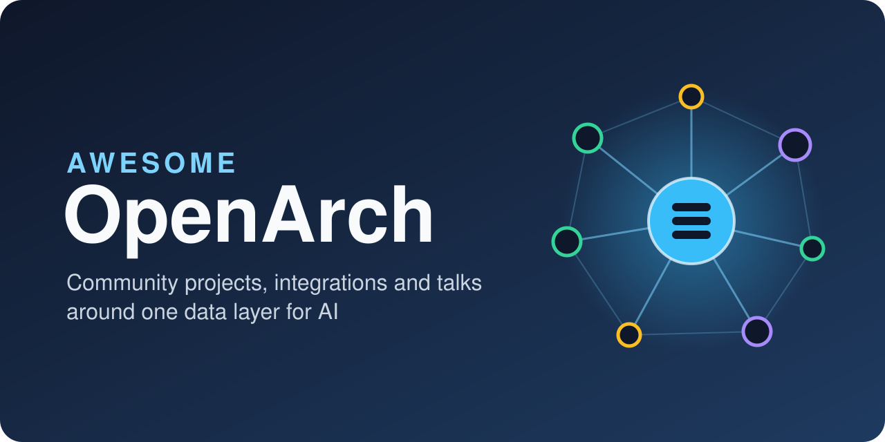
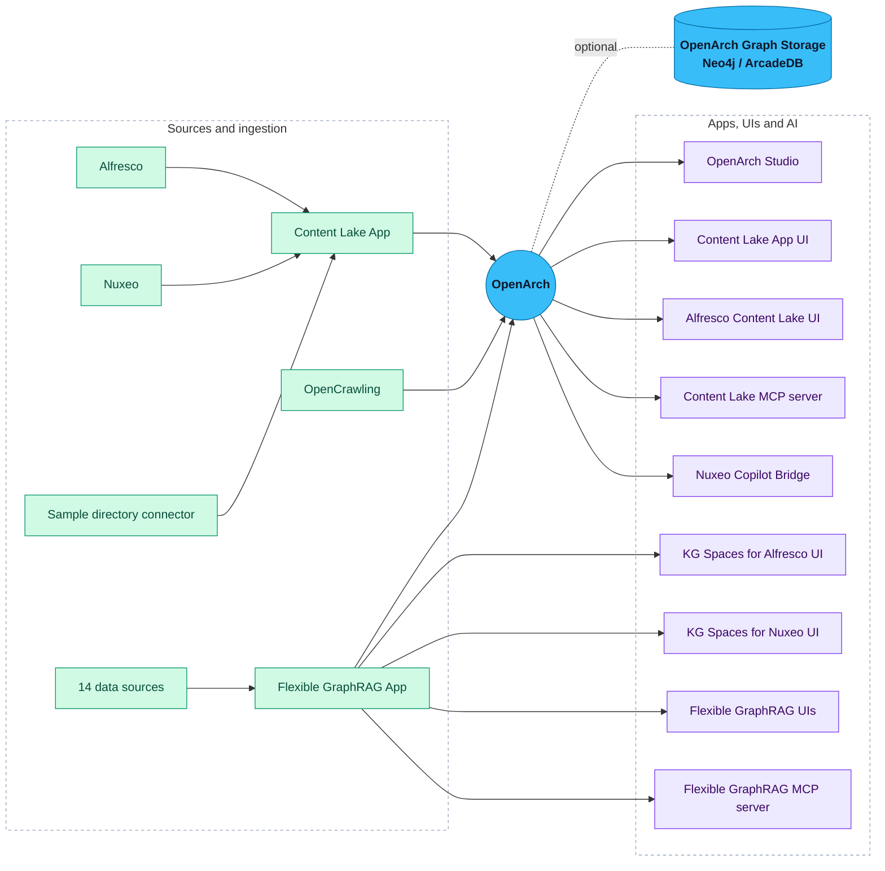

  

  
  
  
  
  
  
  

  <a href="https://github.com/Hyland/OpenArch"><b>OpenArch</b></a> |
  <a href="CONTRIBUTING.md"><b>Contribute</b></a> |
   |
  <a href="https://github.com/topics/openarch"><b>Topic: openarch</b></a>

A curated list of community projects, integrations and talks built around
[Hyland OpenArch](https://github.com/Hyland/OpenArch).

OpenArch is an open source data layer for AI. It stores content, metadata, permissions and
embeddings from any repository, and answers permission-aware queries, including vector search.

This list only links. Each project lives in its author's repository. Projects listed here are
community work and are not supported by Hyland unless the entry says so.

## Contents

- [Get started](#get-started)
- [The OpenArch ecosystem](#the-openarch-ecosystem)
- [Apps and UIs](#apps-and-uis)
- [Connectors and integrations](#connectors-and-integrations)
- [Storage and server plugins](#storage-and-server-plugins)
- [AI and agents](#ai-and-agents)
- [Partner solutions](#partner-solutions)
- [Talks and recordings](#talks-and-recordings)
- [Contributing](#contributing)

## Get started

| I want to | Start here |
| --- | --- |
| Learn what OpenArch is and run it | [Hyland/OpenArch](https://github.com/Hyland/OpenArch) |
| Try permission-aware RAG on Alfresco or Nuxeo content | [Content Lake App Deployment](https://github.com/AlfrescoLabs/content-lake-app-deployment) |
| Connect a new source to OpenArch | [Sample directory connector](https://github.com/AlfrescoLabs/content-lake-app/tree/main/plugins/examples/sample-directory-connector) |
| See a talk first | [TTL #183 - One Data Layer for AI, Any Repository](https://community.hyland.com/discussion/501550/ttl-183-recording-hyland-openarch-one-data-layer-for-ai-any-repository) |

## The OpenArch ecosystem

Content comes in from repositories and connectors. OpenArch keeps it with its permissions.
Apps and AI agents query it as the signed-in user.

## Status

| Badge | Meaning |
| --- | --- |
|  | Try it, expect changes. |
|  | Used in demos or real setups. |
|  | Partner product, not open source. |

## Apps and UIs

| Project | Author | What it does | Status | License |
| --- | --- | --- | --- | --- |
| [OpenArch Studio](https://github.com/haaldinger/openarch-studio) | Heath Aldinger | AI document workspace: Docling extraction, cited RAG chat, reranked search and a knowledge graph. React + FastAPI, local models, calls OpenArch as the signed-in user. |  | Apache-2.0 |
| [Content Lake App](https://github.com/AlfrescoLabs/content-lake-app) | AlfrescoLabs | Syncs Alfresco and Nuxeo content into OpenArch and adds permission-aware RAG on top. |  | Apache-2.0 |
| [Content Lake App UI](https://github.com/AlfrescoLabs/content-lake-app-ui) | AlfrescoLabs | Demo UI for the Content Lake App with dual sign-in (Alfresco + Nuxeo). |  | Apache-2.0 |
| [Alfresco Content Lake UI](https://github.com/AlfrescoLabs/alfresco-content-lake-ui) | AlfrescoLabs | UI extension for ACA or ADW to use the Content Lake App from Alfresco. |  | Apache-2.0 |
| [Content Lake App Deployment](https://github.com/AlfrescoLabs/content-lake-app-deployment) | AlfrescoLabs | Self-contained Docker deployment for the Content Lake App. |  | Apache-2.0 |
| [Flexible GraphRAG App](https://github.com/stevereiner/flexible-graphrag) | Steve Reiner | Python (FastAPI) backend that ingests documents from 14 sources, including Alfresco and Nuxeo, into OpenArch. Adds GraphRAG, hybrid search and AI chat over OpenArch plus property graph and RDF stores. |  | Apache-2.0 |
| [Flexible GraphRAG UIs](https://github.com/stevereiner/flexible-graphrag) | Steve Reiner | Angular, React and Vue frontends for the Flexible GraphRAG App. |  | Apache-2.0 |
| [KG Spaces for Alfresco](https://github.com/stevereiner/kg-spaces-aca) | Steve Reiner | UI extension for ACA or ADW to use the Flexible GraphRAG App from Alfresco. |  | Apache-2.0 |
| [KG Spaces for Nuxeo](https://github.com/stevereiner/kg-spaces-nuxeo) | Steve Reiner | Angular UI companion app for Nuxeo Web UI to use Flexible GraphRAG from Nuxeo. |  | Apache-2.0 |
| [KG Spaces Deployment](https://github.com/stevereiner/kg-spaces-deployment) | Steve Reiner | Docker Compose that deploys the Flexible GraphRAG App, Flexible GraphRAG UIs, KG Spaces UIs, OpenArch, and Alfresco and/or Nuxeo. |  | Apache-2.0 |

## Connectors and integrations

| Project | Author | What it does | Status | License |
| --- | --- | --- | --- | --- |
| [OpenCrawling](https://github.com/opencrawling/opencrawling) | Piergiorgio Lucidi | Open ingestion platform (Java, Spring AI). The OpenArch integration ([PR #175](https://github.com/opencrawling/opencrawling/pull/175)) adds an output connector with Parquet embeddings, OpenArch as a source and an MCP search tool. |  | Apache-2.0 |
| [Sample directory connector](https://github.com/AlfrescoLabs/content-lake-app/tree/main/plugins/examples/sample-directory-connector) | AlfrescoLabs | Minimal example connector for the Content Lake App. Good starting point for a new source. |  | Apache-2.0 |
| [Python OpenArch API](https://github.com/stevereiner/python-openarch-api) | Steve Reiner | Python client for the OpenArch REST API: documents by id and path, HXQL query, vector search and aggregations, users and groups, security policies, upload and download. Sync and async clients on httpx, Pydantic v2 models. |  | Apache-2.0 |

## Storage and server plugins

| Project | Author | What it does | Status | License |
| --- | --- | --- | --- | --- |
| [OpenArch Graph Storage](https://github.com/stevereiner/openarch-graph-storage) | Steve Reiner | Keeps the OpenArch document tree, versions and ACLs in Neo4j or ArcadeDB instead of MongoDB, so knowledge graph entities can link to documents in the same database. Available as a non-default option in [KG Spaces Deployment](https://github.com/stevereiner/kg-spaces-deployment). |  | Apache-2.0 |

## AI and agents

| Project | Author | What it does | Status | License |
| --- | --- | --- | --- | --- |
| [Content Lake App MCP server](https://github.com/AlfrescoLabs/content-lake-app) | AlfrescoLabs | MCP server in `rag-service` with `secureSearch`, `getDocument` and `listSources` tools. ACL-filtered, behind the same auth as the app. |  | Apache-2.0 |
| [Flexible GraphRAG MCP server](https://github.com/stevereiner/flexible-graphrag) | Steve Reiner | MCP server (`flexible-graphrag-mcp`) for Claude Desktop and other MCP clients: tools for ingesting, hybrid search and AI query over the Flexible GraphRAG App, with per-user permission filtering. |  | Apache-2.0 |

## Partner solutions

| Solution | Partner | What it does | Status |
| --- | --- | --- | --- |
| [Nuxeo Copilot Bridge](https://www.prime-force.com) | Prime Force | Brings Hyland Nuxeo into Microsoft 365 Copilot over MCP, always as the signed-in user. Its Ask AI feature is built on OpenArch. |  |

## Talks and recordings

Newest first.

| Event | Talk |
| --- | --- |
| Open Source Conference Luxembourg 2026 | [Sovereign RAG on Your Own Repository: Letting the Search Engine Enforce Permissions](https://pretalx.com/open-source-conference-luxembourg-2026/talk/3Q8XYD/) |
| Hyland Tech Talk Live #183 | [Hyland OpenArch: One Data Layer for AI, Any Repository](https://community.hyland.com/discussion/501550/ttl-183-recording-hyland-openarch-one-data-layer-for-ai-any-repository) |
| Hyland Tech Talk Live #180 | [The Hyland AI Ready Hub: Permission-Aware AI for Alfresco and Nuxeo](https://community.hyland.com/discussion/499982/ttl-180-recordings-the-hyland-ai-ready-hub-permission-aware-ai-for-alfresco-and-nuxeo) |
| Hyland Tech Talk Live #174 | [Hyland's Next Open Source Project](https://community.hyland.com/discussion/495323/ttl-174-recording-hylands-next-open-source-project) |

## Contributing

Found something missing? See [CONTRIBUTING.md](CONTRIBUTING.md), or open a "Suggest a project" issue.
You can also tag your repository with the GitHub topic [`openarch`](https://github.com/topics/openarch)
so others can find it.

## License

This list is released under [CC0 1.0](LICENSE). Each linked project has its own license.
